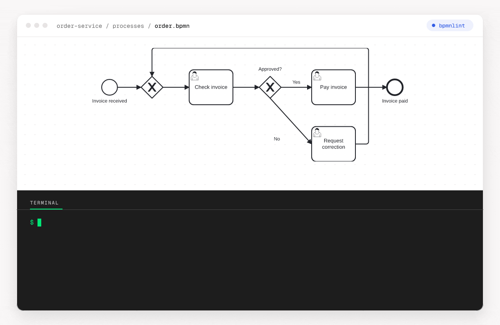

# Miragon bpmnlint-rules

[](https://www.npmjs.com/package/@miragon/bpmnlint-plugin-rules)
[](https://github.com/Miragon/bpmnlint-rules/actions/workflows/ci.yml)
[](LICENSE)

<!-- Hero banner: product name, claim and the linter at work. Not made yet, see the miragon-brand product shots. -->

**Readable, tidy and deployable BPMN models, checked in the modeler, in CI and in your agent's loop.**

`@miragon/bpmnlint-plugin-rules` is a [bpmnlint](https://github.com/bpmn-io/bpmnlint) plugin that
adds Miragon's naming and layout rules and bundles bpmnlint's structural rules and the Camunda 7 / 8
rules, so one `.bpmnlintrc` covers them all. It is pre-1.0: a minor release can break your build, so
pin an exact version and read the [changelog](CHANGELOG.md) first.

## Why

A BPMN model can open fine and still be wrong: the engine rejects it at deploy, its flows cross, or
forty tasks carry ids like `Activity_0049ryx` that no reviewer can follow. Most teams have
conventions against this, kept in a wiki or in one reviewer's head. This plugin turns them into lint
findings.

## What you get

- **Ids people can read.** Rules flag generated ids, and ids, worker topics and message names off
  the scheme you configure ([naming rules](https://miragon.github.io/bpmnlint-rules/rules/naming)).
- **Diagrams that read cleanly.** Rules flag crossing, diagonal and misdocked flows and flows through
  shapes, judged on the drawn coordinates
  ([layout rules](https://miragon.github.io/bpmnlint-rules/rules/layout)).
- **Models the engine accepts.** The Camunda deployability rules come bundled, so a Camunda 8
  service task without a task definition shows up before deploy
  ([Camunda engines](https://miragon.github.io/bpmnlint-rules/guide/engines)).

## Presets

Every rule's severity per preset is on the
[presets page](https://miragon.github.io/bpmnlint-rules/presets).

| Preset                       | For                                                      | Miragon rules                                                        |
| ---------------------------- | -------------------------------------------------------- | -------------------------------------------------------------------- |
| `recommended-for-modeling`   | Hand-drawn models, and modelers that lint while you draw | Layout at `warn`, naming off, a gateway drawn without marker `error` |
| `recommended-for-automation` | Developers who automate processes, locally and in CI     | Id and layout rules at `warn`, scheme and Camunda 7 rules off        |
| `strict`                     | A merge gate that fails on every finding                 | Every rule at `error`, and a minor release can add rules             |

## Rules

| Rule                                                                                                                                 | What it catches                                                                |
| ------------------------------------------------------------------------------------------------------------------------------------ | ------------------------------------------------------------------------------ |
| [`@miragon/rules/no-generated-ids`](https://miragon.github.io/bpmnlint-rules/rules/no-generated-ids)                                 | IDs generated rather than chosen (`Activity_0049ryx`, `StartEvent_1`)          |
| [`@miragon/rules/element-id-naming`](https://miragon.github.io/bpmnlint-rules/rules/element-id-naming)                               | IDs that don't follow the type-prefix + case convention                        |
| [`@miragon/rules/worker-topic-naming`](https://miragon.github.io/bpmnlint-rules/rules/worker-topic-naming)                           | A worker topic (C7 external task topic, C8 job type) off the configured scheme |
| [`@miragon/rules/message-name-naming`](https://miragon.github.io/bpmnlint-rules/rules/message-name-naming)                           | A message name off the configured scheme                                       |
| [`@miragon/rules/flow-through-element`](https://miragon.github.io/bpmnlint-rules/rules/flow-through-element)                         | A sequence flow routed through an unrelated shape's body                       |
| [`@miragon/rules/flow-connection-side`](https://miragon.github.io/bpmnlint-rules/rules/flow-connection-side)                         | A sequence flow docked onto the wrong side of a shape                          |
| [`@miragon/rules/flow-target-alignment`](https://miragon.github.io/bpmnlint-rules/rules/flow-target-alignment)                       | A flow's target drawn off the row, sloping the main path                       |
| [`@miragon/rules/flow-crossing`](https://miragon.github.io/bpmnlint-rules/rules/flow-crossing)                                       | Two sequence flows whose drawn paths cross each other                          |
| [`@miragon/rules/flow-orthogonal`](https://miragon.github.io/bpmnlint-rules/rules/flow-orthogonal)                                   | A sequence flow that runs diagonally instead of horizontal and vertical        |
| [`@miragon/rules/boundary-event-marker-overlap`](https://miragon.github.io/bpmnlint-rules/rules/boundary-event-marker-overlap)       | A boundary event drawn over a marker or icon of its host activity              |
| [`@miragon/rules/exclusive-gateway-marker-visible`](https://miragon.github.io/bpmnlint-rules/rules/exclusive-gateway-marker-visible) | An exclusive gateway drawn without its X marker                                |
| [`@miragon/rules/async-continuations`](https://miragon.github.io/bpmnlint-rules/rules/async-continuations)                           | Camunda 7 save points missing where Camunda recommends them, or redundant      |

## Install

You need Node.js 22 or later. Install the plugin with bpmnlint 11.14 or later, pinned:

```bash
npm install --save-dev --save-exact @miragon/bpmnlint-plugin-rules bpmnlint
```

## Get started

Save this as `.bpmnlintrc` in your project. It extends bpmnlint's structural rules and a preset:

```json
{
  "extends": [
    "bpmnlint:recommended",
    "plugin:@miragon/rules/recommended-for-automation"
  ]
}
```

Then lint your models, pointing the glob at where they live, and fix what it reports:

```bash
npx bpmnlint "processes/**/*.bpmn"
```



Without an engine, the naming, layout and structural rules run as they are. For Camunda,
[add your engine](https://miragon.github.io/bpmnlint-rules/guide/engines); then run the same command
[in CI](https://miragon.github.io/bpmnlint-rules/integrate/ci) and
[after every agent edit](https://miragon.github.io/bpmnlint-rules/integrate/agents).

## With Claude Code

The `bpmnlint-rules` plugin writes your team's BPMN style guide with the matching `.bpmnlintrc`,
checks models against it and fixes their layout. Run in Claude Code:

```text
/plugin marketplace add Miragon/skills
/plugin install bpmnlint-rules@miragon-agent-skills
```

## Help and feedback

- **Documentation:** [miragon.github.io/bpmnlint-rules](https://miragon.github.io/bpmnlint-rules/).
- **Bugs and ideas:** [open an issue](https://github.com/Miragon/bpmnlint-rules/issues).

## Contributing

Pull requests come from the team only; ideas are welcome as issues. Building and testing are in
[CONTRIBUTING.md](CONTRIBUTING.md).

## License

[MIT](LICENSE) © Miragon GmbH
