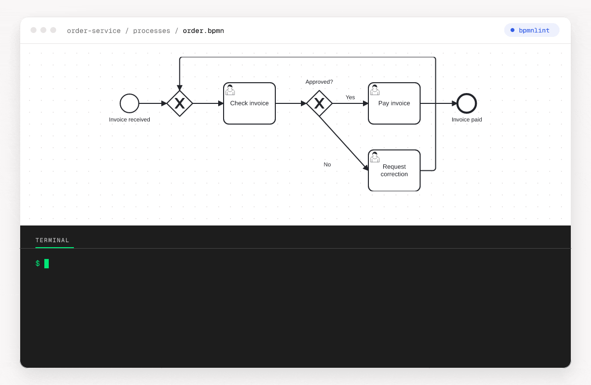

# @miragon/bpmnlint-plugin-rules

[](https://www.npmjs.com/package/@miragon/bpmnlint-plugin-rules)
[](https://github.com/Miragon/bpmnlint-rules/actions/workflows/ci.yml)
[](LICENSE)

A [bpmnlint](https://github.com/bpmn-io/bpmnlint) plugin that keeps BPMN diagrams clean: a few
Miragon naming and layout conventions, plus the standard structural rules and the Camunda 7 / 8
deployability rules bundled in — so you don't wire up bpmnlint's plugins yourself.



## Why

A BPMN diagram can be well-formed and still be wrong — a missing start event, a construct the engine
rejects at deploy, or forty tasks named `Activity_0049ryx` that no reviewer can read. Linting catches
that automatically, wherever BPMN is written:

- **In the modeler** — live feedback while you draw, so a mistake is flagged the moment you make it.
- **In CI** — a merge/deploy gate, so a broken model never ships.
- **For AI** — agents emit valid-but-off models (machine IDs, orphan nodes, engine-invalid
  constructs); lint their output and block on error, instead of hoping a human catches it.

Most teams already have these conventions — in a wiki, or in one reviewer's head. This plugin makes
them executable.

<!-- #region setup -->

## Install

Install the plugin together with `bpmnlint` (its peer dependency):

```bash
npm install --save-dev @miragon/bpmnlint-plugin-rules bpmnlint
```

## Use it (the bpmnlint way)

Add the plugin to your `.bpmnlintrc` and extend one of its configs, like any other plugin.
`bpmnlint:recommended` brings the standard structural rules, and the second entry adds the Miragon
layer, here `recommended-for-modeling`:

```json
{
  "extends": [
    "bpmnlint:recommended",
    "plugin:@miragon/rules/recommended-for-modeling"
  ]
}
```

It ships three configs — pick one by who's modeling and why:

<!-- #region presets -->

- `plugin:@miragon/rules/recommended-for-modeling` — for **purely business/technical models**, and for
  **modeler applications that surface linting** to their users. Layout hints only: bpmnlint's
  `standard-size` and the layout rules at `warn`, the naming/id rules **off** — a modeler is never
  blocked on execution-only conventions.
- `plugin:@miragon/rules/recommended-for-automation` — for **developers automating processes**, locally
  and in CI, on models wired up to a Camunda engine. Every Miragon rule on but as a non-blocking `warn`
  (`standard-size` too), so ids and layout get flagged without failing the build.
- `plugin:@miragon/rules/all` — every Miragon rule at `error`, engine-agnostic. The strict gate to opt
  into when you want findings to fail the build.

<!-- #endregion presets -->

Then lint a diagram:

```bash
npx bpmnlint diagram.bpmn
```

<!-- #endregion setup -->

## Rules

The Miragon conventions this plugin adds — each with a docs page and a good/bad example:

| Rule                                                                                                | What it catches                                                                |
| --------------------------------------------------------------------------------------------------- | ------------------------------------------------------------------------------ |
| [`@miragon/rules/no-generated-ids`](docs/rules/no-generated-ids.md)                                 | IDs generated rather than chosen (`Activity_0049ryx`, `StartEvent_1`)          |
| [`@miragon/rules/element-id-naming`](docs/rules/element-id-naming.md)                               | IDs that don't follow the type-prefix + case convention                        |
| [`@miragon/rules/worker-topic-naming`](docs/rules/worker-topic-naming.md)                           | A worker topic (C7 external task topic, C8 job type) off the configured scheme |
| [`@miragon/rules/message-name-naming`](docs/rules/message-name-naming.md)                           | A message name off the configured scheme                                       |
| [`@miragon/rules/flow-through-element`](docs/rules/flow-through-element.md)                         | A sequence flow routed through an unrelated shape's body                       |
| [`@miragon/rules/flow-connection-side`](docs/rules/flow-connection-side.md)                         | A sequence flow docked onto the wrong side of a shape                          |
| [`@miragon/rules/flow-target-alignment`](docs/rules/flow-target-alignment.md)                       | A flow's target drawn off the row, sloping the main path                       |
| [`@miragon/rules/flow-crossing`](docs/rules/flow-crossing.md)                                       | Two sequence flows whose drawn paths cross each other                          |
| [`@miragon/rules/flow-orthogonal`](docs/rules/flow-orthogonal.md)                                   | A sequence flow that runs diagonally instead of horizontal and vertical        |
| [`@miragon/rules/boundary-event-marker-overlap`](docs/rules/boundary-event-marker-overlap.md)       | A boundary event drawn over a marker or icon of its host activity              |
| [`@miragon/rules/exclusive-gateway-marker-visible`](docs/rules/exclusive-gateway-marker-visible.md) | An exclusive gateway drawn without its X marker                                |
| [`@miragon/rules/async-continuations`](docs/rules/async-continuations.md)                           | Camunda 7 save points missing where Camunda recommends them, or redundant      |

### Camunda engine rules

The checks camunda-compat leaves out, one rule per check: `plugin:@miragon/rules/camunda-7` and
`plugin:@miragon/rules/camunda-8` (see [Miragon engine layers](#miragon-engine-layers)). Each rule
only checks diagrams for its engine.

#### Camunda 7

| Rule                                                                                          | What the engine refuses, ignores or misreads                                                                                                                              |
| --------------------------------------------------------------------------------------------- | ------------------------------------------------------------------------------------------------------------------------------------------------------------------------- |
| [`@miragon/rules/c7-ad-hoc-sub-process`](docs/rules/c7-ad-hoc-sub-process.md)                 | Ad-hoc sub-processes with flows, boundary events or a multi-instance loop, which Camunda 7 refuses to deploy                                                              |
| [`@miragon/rules/c7-async-duplicate-extension`](docs/rules/c7-async-duplicate-extension.md)   | A second failedJobRetryTimeCycle on an element that is not asynchronous yet                                                                                               |
| [`@miragon/rules/c7-attribute-value`](docs/rules/c7-attribute-value.md)                       | A job or task priority that is not a number or expression, an unknown camunda:mapDecisionResult                                                                           |
| [`@miragon/rules/c7-bad-value`](docs/rules/c7-bad-value.md)                                   | A value that deploys but fails or is ignored at run time (empty topic, unknown binding, bad priority)                                                                     |
| [`@miragon/rules/c7-binding-version`](docs/rules/c7-binding-version.md)                       | A version or versionTag binding without the version it binds to                                                                                                           |
| [`@miragon/rules/c7-boundary-host`](docs/rules/c7-boundary-host.md)                           | Reports a boundary event attached to a compensation handler, which the engine refuses to deploy                                                                           |
| [`@miragon/rules/c7-called-element`](docs/rules/c7-called-element.md)                         | A call activity without calledElement, or with both calledElement and camunda:caseRef                                                                                     |
| [`@miragon/rules/c7-complex-gateway`](docs/rules/c7-complex-gateway.md)                       | Connected complex gateways, which Camunda 7 does not run and refuses to deploy                                                                                            |
| [`@miragon/rules/c7-dangling-reference`](docs/rules/c7-dangling-reference.md)                 | An errorRef inside camunda content that points to an element of another type                                                                                              |
| [`@miragon/rules/c7-definitions-extension`](docs/rules/c7-definitions-extension.md)           | Extension elements directly under bpmn:definitions, which Camunda 7 refuses to deploy                                                                                     |
| [`@miragon/rules/c7-duplicate-extension`](docs/rules/c7-duplicate-extension.md)               | A second inputOutput, connector, formData or failedJobRetryTimeCycle where the engines read one (ENGINE-01009)                                                            |
| [`@miragon/rules/c7-empty-condition`](docs/rules/c7-empty-condition.md)                       | Conditions without expression or script that Camunda 7 deploys but fails to evaluate                                                                                      |
| [`@miragon/rules/c7-error`](docs/rules/c7-error.md)                                           | Reports an error end event without an error or whose error has no errorCode                                                                                               |
| [`@miragon/rules/c7-escalation`](docs/rules/c7-escalation.md)                                 | Reports escalation throw events without an escalation or escalationCode, and escalation boundary events on a task other than a user task                                  |
| [`@miragon/rules/c7-event-definition`](docs/rules/c7-event-definition.md)                     | Reports timers without a value, conditional events without a condition, timers with several time elements and compensation of an activity outside the throw event's scope |
| [`@miragon/rules/c7-event-gateway`](docs/rules/c7-event-gateway.md)                           | Event-based gateway branches Camunda 7 refuses: no message, timer, signal or conditional catch event, other incoming flows, or a shared message or signal name            |
| [`@miragon/rules/c7-exclusive-gateway`](docs/rules/c7-exclusive-gateway.md)                   | Exclusive gateways Camunda 7 refuses: no outgoing flow, a conditioned single or default flow, or flows without condition next to a default                                |
| [`@miragon/rules/c7-extension`](docs/rules/c7-extension.md)                                   | Camunda extension content the engines refuse (in/out without source or target, nameless parameters, form fields, connectors, fields without value)                        |
| [`@miragon/rules/c7-external-topic`](docs/rules/c7-external-topic.md)                         | An external task without camunda:topic                                                                                                                                    |
| [`@miragon/rules/c7-foreign-content`](docs/rules/c7-foreign-content.md)                       | Zeebe attributes and extension elements, which Camunda 7 ignores                                                                                                          |
| [`@miragon/rules/c7-form`](docs/rules/c7-form.md)                                             | A camunda:formRef without a known binding, or next to camunda:formKey                                                                                                     |
| [`@miragon/rules/c7-history-time-to-live`](docs/rules/c7-history-time-to-live.md)             | A camunda:historyTimeToLive that is not a number of days                                                                                                                  |
| [`@miragon/rules/c7-implementation`](docs/rules/c7-implementation.md)                         | A task or message throw event without an implementation, with an unsupported camunda:type, or a broken shell task                                                         |
| [`@miragon/rules/c7-implicit-default-flow`](docs/rules/c7-implicit-default-flow.md)           | An exclusive gateway whose one unconditioned flow Camunda 7 takes as an implicit default                                                                                  |
| [`@miragon/rules/c7-input-output`](docs/rules/c7-input-output.md)                             | Camunda:inputOutput on start or boundary events, gateways and event sub-processes, output mappings on end events and multi-instance activities                            |
| [`@miragon/rules/c7-link-event`](docs/rules/c7-link-event.md)                                 | Reports link events without a name, link catch names used twice in a process and link throw events without a catch event in their scope                                   |
| [`@miragon/rules/c7-listener`](docs/rules/c7-listener.md)                                     | Execution and task listeners the engines refuse (no implementation, unknown or missing event, timeout listeners without timer or id)                                      |
| [`@miragon/rules/c7-message-implementation`](docs/rules/c7-message-implementation.md)         | A message throw or end event without an implementation, which sends nothing                                                                                               |
| [`@miragon/rules/c7-message`](docs/rules/c7-message.md)                                       | Reports message catch events without a message, messages without a name and two message subscriptions with one name in one scope                                          |
| [`@miragon/rules/c7-misplaced-attribute`](docs/rules/c7-misplaced-attribute.md)               | Camunda attributes on an element or event side the engines do not read them on                                                                                            |
| [`@miragon/rules/c7-misplaced-extension`](docs/rules/c7-misplaced-extension.md)               | Camunda extension elements on a host or event side the engines do not read them on                                                                                        |
| [`@miragon/rules/c7-multi-instance`](docs/rules/c7-multi-instance.md)                         | A multi-instance loop without cardinality or collection                                                                                                                   |
| [`@miragon/rules/c7-multiple-event-definitions`](docs/rules/c7-multiple-event-definitions.md) | Reports an event with several event definitions, of which the engine acts on one only                                                                                     |
| [`@miragon/rules/c7-result-variable`](docs/rules/c7-result-variable.md)                       | Camunda:resultVariable next to camunda:class or camunda:delegateExpression                                                                                                |
| [`@miragon/rules/c7-schema`](docs/rules/c7-schema.md)                                         | Unprefixed attributes the BPMN schema does not define, which Camunda 7 refuses to deploy                                                                                  |
| [`@miragon/rules/c7-script`](docs/rules/c7-script.md)                                         | A script task with neither a script nor camunda:resource                                                                                                                  |
| [`@miragon/rules/c7-signal`](docs/rules/c7-signal.md)                                         | Reports signal events without a signal, signals without a name, two signal subscriptions with one name in one scope and duplicate signal names                            |
| [`@miragon/rules/c7-start-event`](docs/rules/c7-start-event.md)                               | Reports a process or sub-process without a start event, a second none or timer start event of a process and a second start event of a sub-process                         |
| [`@miragon/rules/c7-transaction-start`](docs/rules/c7-transaction-start.md)                   | Reports a transaction without a start event, which fails every instance that reaches it                                                                                   |
| [`@miragon/rules/c7-unknown-attribute`](docs/rules/c7-unknown-attribute.md)                   | Camunda attributes the descriptor does not know, such as a typo                                                                                                           |

#### Camunda 8

| Rule                                                                                        | What the engine refuses, ignores or misreads                                                                                                                                |
| ------------------------------------------------------------------------------------------- | --------------------------------------------------------------------------------------------------------------------------------------------------------------------------- |
| [`@miragon/rules/c8-ad-hoc-sub-process`](docs/rules/c8-ad-hoc-sub-process.md)               | Reports start and end events inside an ad-hoc sub-process                                                                                                                   |
| [`@miragon/rules/c8-bad-value`](docs/rules/c8-bad-value.md)                                 | Job retries that are no number, task headers without key or value                                                                                                           |
| [`@miragon/rules/c8-boundary-host`](docs/rules/c8-boundary-host.md)                         | A Camunda 8 boundary event on a compensation handler                                                                                                                        |
| [`@miragon/rules/c8-duplicate-extension`](docs/rules/c8-duplicate-extension.md)             | A second zeebe extension element Camunda 8 reads once per element                                                                                                           |
| [`@miragon/rules/c8-error`](docs/rules/c8-error.md)                                         | Reports error catch events with a FEEL error code, non-interrupting error events and one error code twice in a scope                                                        |
| [`@miragon/rules/c8-event-definition`](docs/rules/c8-event-definition.md)                   | Reports event definitions the engine refuses (several on one event, a none event sub-process start, a missing definition id, a misplaced compensation, a condition missing) |
| [`@miragon/rules/c8-event-gateway`](docs/rules/c8-event-gateway.md)                         | Reports an event-based gateway with fewer than two outgoing flows or a target other than a message, timer, signal or conditional catch event                                |
| [`@miragon/rules/c8-extension`](docs/rules/c8-extension.md)                                 | Zeebe extension content Camunda 8 refuses (binding type, linked resource, variable events, header keys)                                                                     |
| [`@miragon/rules/c8-feel-completion-condition`](docs/rules/c8-feel-completion-condition.md) | A multi-instance completion condition that is no FEEL expression                                                                                                            |
| [`@miragon/rules/c8-feel-expression`](docs/rules/c8-feel-expression.md)                     | A FEEL value with a syntax slip, or a static / JUEL value where Camunda 8 needs FEEL                                                                                        |
| [`@miragon/rules/c8-foreign-content`](docs/rules/c8-foreign-content.md)                     | Camunda 7 attributes and extension elements, which Camunda 8 ignores                                                                                                        |
| [`@miragon/rules/c8-implementation`](docs/rules/c8-implementation.md)                       | A send task or message throw event whose message has no name                                                                                                                |
| [`@miragon/rules/c8-link-event`](docs/rules/c8-link-event.md)                               | Reports a link throw event without a matching catch in its scope, and link definitions without a name                                                                       |
| [`@miragon/rules/c8-listener`](docs/rules/c8-listener.md)                                   | Execution and task listeners Camunda 8 refuses (event type, placement, job worker user task)                                                                                |
| [`@miragon/rules/c8-message`](docs/rules/c8-message.md)                                     | Reports a FEEL message name on a process start event and one message name twice among events subscribed together                                                            |
| [`@miragon/rules/c8-misplaced-attribute`](docs/rules/c8-misplaced-attribute.md)             | A zeebe attribute on an element that does not carry it                                                                                                                      |
| [`@miragon/rules/c8-misplaced-extension`](docs/rules/c8-misplaced-extension.md)             | Zeebe extension elements where Camunda 8 does not read them                                                                                                                 |
| [`@miragon/rules/c8-schema`](docs/rules/c8-schema.md)                                       | Unprefixed attributes the BPMN schema does not define, extension elements on definitions, ids that are no NCName                                                            |
| [`@miragon/rules/c8-signal`](docs/rules/c8-signal.md)                                       | Reports a FEEL signal name on a start event and one signal name twice on process starts or one activity's boundary events                                                   |
| [`@miragon/rules/c8-start-event`](docs/rules/c8-start-event.md)                             | Reports a triggered start event of an embedded sub-process and several start events in one sub-process                                                                      |
| [`@miragon/rules/c8-unknown-attribute`](docs/rules/c8-unknown-attribute.md)                 | Zeebe attributes Camunda 8 does not know, which it ignores                                                                                                                  |

Turn any of them on individually, the usual way:

```json
{
  "extends": [
    "bpmnlint:recommended",
    "plugin:@miragon/rules/recommended-for-modeling"
  ],
  "rules": {
    "@miragon/rules/no-generated-ids": "error",
    "@miragon/rules/element-id-naming": "warn"
  }
}
```

Structural checks — start/end events, connectivity, element sizing — come from bpmnlint's own
[`bpmnlint:recommended`](https://github.com/bpmn-io/bpmnlint/blob/main/docs/rules/README.md). The
Miragon set grows over time; see [CONTRIBUTING.md](CONTRIBUTING.md) to propose a rule.

<!-- #region usage -->

## In CI

<!-- #region ci -->

Lint every model as a merge gate — bpmnlint exits non-zero on a finding, failing the build:

```bash
npx bpmnlint 'models/**/*.bpmn'
```

<!-- #endregion ci -->

## Camunda engine rules

<!-- #region engines -->

Deploying to a Camunda engine? Add its deployability layer (bundled — no separate install) to your
`extends`. These rules read engine-specific properties, so bpmnlint must also parse them with the
matching moddle extension — pick the config for your engine below.

**The `moddleExtensions` line is not optional.** Without it the parser doesn't recognize the engine
namespace, so those properties are invisible to the rules — they then report false findings (for
example a service task flagged as missing its task definition even though it has one). A modeler loads
the moddle already; it's the bare `npx bpmnlint` CLI that needs this line. Prefer to skip the wiring?
The programmatic `getDefaultLintConfig({ engine })` below sets up both the layer and its moddle
extension for you.

### Camunda 7

```json
{
  "extends": [
    "bpmnlint:recommended",
    "plugin:@miragon/rules/recommended-for-automation",
    "plugin:camunda-compat/camunda-platform-7-24"
  ],
  "moddleExtensions": {
    "camunda": "camunda-bpmn-moddle/resources/camunda.json"
  }
}
```

### Camunda 8 (Zeebe)

```json
{
  "extends": [
    "bpmnlint:recommended",
    "plugin:@miragon/rules/recommended-for-automation",
    "plugin:camunda-compat/camunda-cloud-8-10"
  ],
  "moddleExtensions": {
    "zeebe": "zeebe-bpmn-moddle/resources/zeebe.json"
  }
}
```

### Older engine versions

Both examples name the config for the latest engine version. camunda-compat ships one config per
version, from `camunda-platform-7-19` and `camunda-cloud-1-0` on: put your engine's version in the
name, for example `plugin:camunda-compat/camunda-cloud-8-5`. The bpmnlint CLI loads it from the
installed `bpmnlint-plugin-camunda-compat`.

The bundled resolver, `createBundledResolver()`, carries every `camunda-platform-7-*` and
`camunda-cloud-8-*` config, so a host that has only the bundle, such as a browser modeler, lints
against any of them. `getDefaultLintConfig({ engine, version })` picks the config of that version
(`'8.5'`, or `'8.5.2'` as `modeler:executionPlatformVersion` writes it), the nearest older one when
camunda-compat has none for it, and the latest without a version. For the Camunda Cloud 1.x configs,
chain bpmnlint's `NodeResolver` behind the bundle, so the configs and rules the bundle does not
carry load from the installed packages:

```ts
import NodeResolver from 'bpmnlint/lib/resolver/node-resolver.js';
import { createBundledResolver } from '@miragon/bpmnlint-plugin-rules';

const bundled = createBundledResolver();
// loads packages from the node_modules of the working directory
const installed = new NodeResolver();

// the bundle first, the installed packages for what it does not carry
function chained(method: 'resolveRule' | 'resolveConfig') {
  return (pkg: string, name: string) => {
    try {
      return bundled[method](pkg, name);
    } catch {
      return installed[method](pkg, name);
    }
  };
}

const resolver = {
  resolveRule: chained('resolveRule'),
  resolveConfig: chained('resolveConfig'),
};
```

Pass this `resolver` to the `Linter` in place of `createBundledResolver()`, with an `extends` that
names the older config.

### Miragon engine layers

camunda-compat covers what Camunda 8 refuses on deploy only in part, and Camunda 7 hardly at all.
`plugin:@miragon/rules/camunda-7` and `plugin:@miragon/rules/camunda-8` add the checks it leaves
out. Each rule's severity says what its finding means: `error` when the engine refuses the file,
`warn` when it deploys but fails or ignores the setting at run time, `info` when it works, but not as
a reader expects. `getDefaultLintConfig({ engine })` adds the layer next to camunda-compat's config.

A host that checks the structure itself and loads one engine on demand imports that engine alone:

```ts
import { camunda8 } from '@miragon/bpmnlint-plugin-rules/camunda-8';

// camunda-compat's config for the version + plugin:@miragon/rules/camunda-8
const config = camunda8.lintConfig('8.9');
const linter = new Linter({
  config,
  resolver: camunda8.createResolver(),
});
```

Every engine report carries camunda-compat's `path` to the property it is about and its
`data.type` (`ERROR_TYPES`, such as `camunda.propertyRequired`), so a host can build its own hint
from them.

<!-- #endregion engines -->

## Programmatic use

<!-- #region programmatic -->

Building a linter in code — a modeler, a CI script, an agent loop? Skip `.bpmnlintrc` and use the
bundled resolver. It carries every layer (structural + Camunda + Miragon), so there's nothing else
to wire up, and it works offline:

```ts
import { BpmnModdle } from 'bpmn-moddle';
import { Linter } from 'bpmnlint';
import {
  createBundledResolver,
  getDefaultLintConfig,
} from '@miragon/bpmnlint-plugin-rules';

// 'c7' | 'c8', omit for structural-only
const config = getDefaultLintConfig({ engine: 'c8' });

// parse with the config's moddle extensions, or the engine rules
// cannot see the engine properties
const moddle = new BpmnModdle(config.moddleExtensions);
const { rootElement } = await moddle.fromXML(xml);

const linter = new Linter({
  config,
  resolver: createBundledResolver(),
});

const results = await linter.lint(rootElement);
```

`engine` picks the Camunda deployability layer + typed moddle; `preset` picks the Miragon opinion
layer independently — `'modeling'` (layout hints only, safe on hand-drawn diagrams) or
`'automation'` (every Miragon rule at `error`). When `preset` is omitted it defaults to
`'automation'` for an engine-bound config and `'modeling'` otherwise. Pass both to decouple them —
e.g. a modeler that wants Camunda 8's typed properties and deployability checks but the relaxed
modeling opinion layer:

```ts
getDefaultLintConfig({ engine: 'c8', preset: 'modeling' });
```

Results are keyed by rule; each finding has a `category` (`error` | `warn`). Block on any error — a
CI gate, or the reject signal that sends an AI agent back to fix its output:

```ts
const errors = Object.values(results)
  .flat()
  .filter((finding) => finding.category === 'error');

if (errors.length) process.exit(1);
```

Every rule factory, rule-set and helper is exported from the package root as well.

<!-- #endregion programmatic -->

<!-- #endregion usage -->

## Alternatives

bpmnlint lints one model at a time, so it is the right fit for anything stylistic or about the
correctness of a single diagram. It checks naming conventions, layout, structural soundness, and
whether a construct is deployable to a given engine.

However, it cannot answer engine- and automation-specific questions that span a running process, because those
depend on more than the diagram in front of it. Whether a call activity passes every variable its
child process needs, or whether the technical wiring is correct, is something a model-in-isolation
linter simply cannot see. For those cases, and when you want to keep such tests alongside your model
in the same build (for example a Gradle task), [Miragon/bpmn-to-code](https://github.com/Miragon/bpmn-to-code)
and its [process testing](https://github.com/Miragon/bpmn-to-code/pull/79) are the better tool.

## Where it is used

- **[Miragon BPMN Modeler](https://github.com/Miragon/bpmn-modeler)** — in-editor linting via the
  programmatic API, flagging issues live while you model.

- **[Claude Code plugin](plugins/bpmnlint-rules)** — skills that write a team BPMN style guide, generate
  the matching `.bpmnlintrc`, check models against the guide, and review and fix their layout.

## Contributing

See [CONTRIBUTING.md](CONTRIBUTING.md).

## License

[MIT](LICENSE) © Miragon GmbH.
