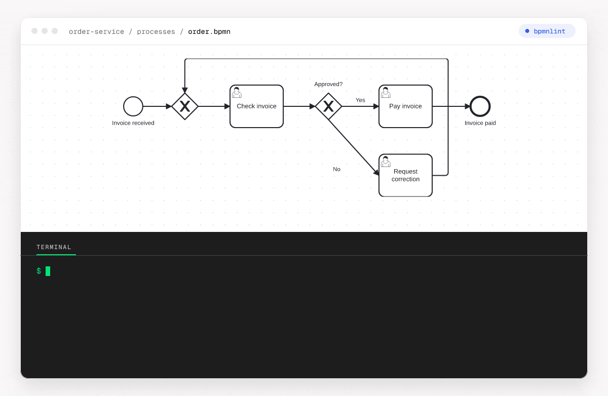

# bpmnlint-rules

[](https://www.npmjs.com/package/@miragon/bpmnlint-plugin-rules)
[](https://github.com/Miragon/bpmnlint-rules/actions/workflows/ci.yml)
[](LICENSE)



Readable, tidy and deployable BPMN models, checked in your pull requests, in any CI, in the modeler and in your agent's loop. It adds [Miragon](https://www.miragon.io/)'s naming and layout rules to [bpmnlint](https://github.com/bpmn-io/bpmnlint) and bundles bpmnlint's structural rules and the Camunda 7 / 8 rules. Pre-1.0: pin an exact version and read the [changelog](CHANGELOG.md).

## Why

A BPMN model can open fine and still be wrong: the engine rejects it at deploy, its flows cross, or forty tasks carry ids like `Activity_0049ryx` that no reviewer can follow. Most teams keep conventions against this in a wiki or in one reviewer's head. These rules turn them into lint findings.

## What you get

- **Ids people can read.** Flags generated ids and ids, worker topics and message names off your naming scheme ([naming rules](https://miragon.github.io/bpmnlint-rules/rules/naming)).
- **Diagrams that read cleanly.** Flags crossing, diagonal and wrongly docked flows and flows through shapes ([layout rules](https://miragon.github.io/bpmnlint-rules/rules/layout)).
- **Models the engine accepts.** Add your Camunda version's layer to the config, and engine errors show up before deploy ([Camunda engines](https://miragon.github.io/bpmnlint-rules/guide/engines)).

## Ways to use it

One bpmnlint config, `.bpmnlintrc`, drives all of them. Without one, the `recommended-for-automation` preset applies.

| You want                                                              | Use                                                                               |
| --------------------------------------------------------------------- | --------------------------------------------------------------------------------- |
| Findings as a comment on every pull request, errors fail the check    | [GitHub Action](https://miragon.github.io/bpmnlint-rules/integrate/github-action) |
| The same check in GitLab, Jenkins or your terminal, as text or report | [CLI `miragon-bpmnlint`](https://miragon.github.io/bpmnlint-rules/integrate/cli)  |
| The rules in `npx bpmnlint` or a modeler that runs bpmnlint           | [bpmnlint plugin](https://miragon.github.io/bpmnlint-rules/guide)                 |
| Your coding agent checks and fixes the models it writes               | [Coding agents](https://miragon.github.io/bpmnlint-rules/integrate/agents)        |
| Linting inside a modeler or tool you build                            | [Lint from code](https://miragon.github.io/bpmnlint-rules/integrate/api)          |

## Get started

**In pull requests:** save this as `.github/workflows/bpmnlint.yml` ([all options](https://miragon.github.io/bpmnlint-rules/integrate/github-action)).

<!-- x-release-please-start-version -->

```yaml
name: BPMN lint
on: pull_request
permissions:
  contents: read
  pull-requests: write
jobs:
  bpmnlint:
    runs-on: ubuntu-latest
    steps:
      - uses: actions/checkout@v5
      - uses: Miragon/bpmnlint-rules@v0.25.0
```

<!-- x-release-please-end -->

**On your machine (Node.js 22 or later):** install the plugin with bpmnlint, pinned.

```bash
npm install --save-dev --save-exact @miragon/bpmnlint-plugin-rules bpmnlint
```

Save this as `.bpmnlintrc`, then run `npx bpmnlint "processes/**/*.bpmn"`.

```json
{
  "extends": [
    "bpmnlint:recommended",
    "plugin:@miragon/rules/recommended-for-automation"
  ]
}
```

This preset reports Miragon findings as warnings, which never fail a run. `recommended-for-modeling` fits hand-drawn diagrams, `strict` makes every finding an error: [Presets](https://miragon.github.io/bpmnlint-rules/presets). Camunda 7 and 8 models need [two more config entries](https://miragon.github.io/bpmnlint-rules/guide/engines).

## With your AI assistant

The `bpmnlint-rules` Claude Code plugin writes your team's BPMN style guide with the matching `.bpmnlintrc`, checks models against it and fixes their layout:

```text
/plugin marketplace add Miragon/skills
/plugin install bpmnlint-rules@miragon-agent-skills
```

## Help and feedback

- **Documentation:** every rule, preset and integration at [miragon.github.io/bpmnlint-rules](https://miragon.github.io/bpmnlint-rules/).
- **Bugs and ideas:** false positive or missing rule? [Open an issue](https://github.com/Miragon/bpmnlint-rules/issues).

## Contributing

We don't accept pull requests from outside the team. How to build, test and change the project is in [CONTRIBUTING.md](CONTRIBUTING.md).

## License

[MIT](LICENSE) © Miragon GmbH
