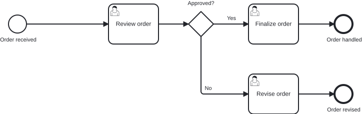
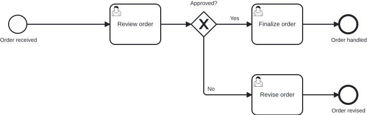

# `@miragon/rules/exclusive-gateway-marker-visible`

> This rule is an `error` in `plugin:@miragon/rules/recommended-for-modeling` (a gateway without its marker is misdrawn, not merely untidy) and in `plugin:@miragon/rules/all`. It is a non-blocking `warn` in `plugin:@miragon/rules/recommended-for-automation`. Override it to `warn`, `error` or `off` yourself.

Reports an exclusive gateway drawn without its `X` marker.

## Why

Whether the `X` is drawn depends on `isMarkerVisible` on the gateway's `BPMNShape`, and the BPMN
specification defaults that attribute to `false`. Without it the gateway renders as an empty
diamond. A stakeholder reading the diagram then has to guess whether the branches are exclusive,
and the model looks different from every other diagram the team draws in the Camunda Modeler,
which always writes the attribute.

## Why this matters for agentic BPMN

Agents and generators write the DI layer from scratch and leave out attributes that are optional
in the schema. The semantic model stays correct, so the XML review shows nothing; the missing
marker appears only once the diagram is rendered.

**Typical AI artifact without this rule:** a `bpmndi:BPMNShape` for a decision gateway with bounds
but without `isMarkerVisible="true"`, rendered as a blank diamond.

**What this rule guarantees:** every exclusive gateway shows its `X` marker.

## Scope

The rule reads the DI layer of every diagram: each `BPMNShape` whose element is a
`bpmn:ExclusiveGateway` must carry `isMarkerVisible="true"`. A missing attribute and an explicit
`false` are both reported.

It does not report other gateway types (parallel, inclusive, event-based, complex), since their
marker is always drawn and the attribute has no effect on them.

## Examples

An order review that branches on whether the order is approved. The two pictures share the same
model; only the gateway's DI attribute differs.

👎 Invalid: `gateway_approved` is drawn as an empty diamond



👍 Valid: the same gateway with its `X` marker visible



The same, as XML. 👎 wrong:

```xml
<bpmndi:BPMNShape id="gateway_approved_di" bpmnElement="gateway_approved">
  <dc:Bounds x="520" y="175" width="50" height="50" />
</bpmndi:BPMNShape>
```

👍 right:

```xml
<bpmndi:BPMNShape id="gateway_approved_di" bpmnElement="gateway_approved" isMarkerVisible="true">
  <dc:Bounds x="520" y="175" width="50" height="50" />
</bpmndi:BPMNShape>
```

## Further reading

- [Camunda: Creating readable process models](https://docs.camunda.io/docs/components/best-practices/modeling/creating-readable-process-models/): recommends always drawing the exclusive gateway marker.
