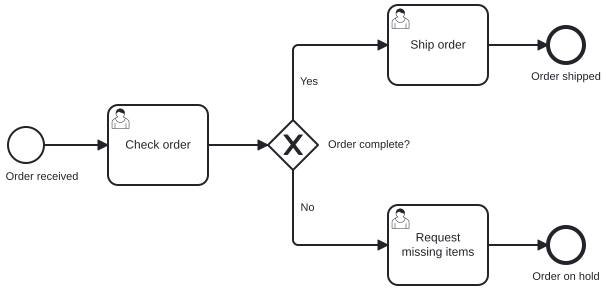
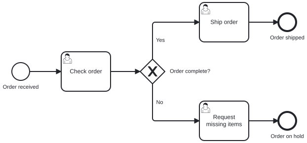

# `@miragon/rules/label-alignment`

> This rule is **off** in every preset, `plugin:@miragon/rules/strict` included (it is a cosmetic check: an off-centre label looks untidy, but it is still read correctly). Enable it by name in your `.bpmnlintrc`.

Reports an event or gateway label that sits above, below, left or right of its element but more than 2px off the element's centre line.

## Why

bpmn-js centres a label under its event or gateway, and readers take that alignment as the sign of which element a label belongs to. A label a few pixels to one side looks untidy in the rendered diagram a stakeholder reviews or a slide shows, and a row of events whose labels drift by different amounts looks careless. The process is still read correctly, which is why the rule is off unless you ask for it.

## Why this matters for agentic BPMN

Agents and auto-layout write label bounds as plain numbers. A label computed from a rounded width, or kept at its old position after its element was resized or renamed, ends up a few pixels off. The XML diff shows a valid `<bpmndi:BPMNLabel>`, and nobody notices the drift until the diagram is rendered.

**Typical AI artifact without this rule:** an end event whose label was widened for a longer name but kept its left edge, so it now hangs to the right of the event.

**What this rule guarantees:** every event and gateway label on one side of its element is centred on that side, within 2px.

## Enable it

Add the rule to the `rules` of your `.bpmnlintrc`, next to whatever preset you extend:

```json
{
  "extends": [
    "bpmnlint:recommended",
    "plugin:@miragon/rules/recommended-for-modeling"
  ],
  "rules": {
    "@miragon/rules/label-alignment": "warn"
  }
}
```

## Scope

The rule looks at the label bounds (`<bpmndi:BPMNLabel>`) of named events and gateways and finds the side of the element the label sits on:

- **above or below:** the label lies entirely above or below the element and shares part of its x range; it has to be centred horizontally;
- **left or right:** the label lies entirely beside the element and shares part of its y range; it has to be centred vertically.

The rule does not prescribe the side. An event usually has its label below, and a gateway whose flows leave at the top and the bottom has it on the right; both are checked the same way. A label is reported when its centre is more than 2px off the element's centre line, measured to a tenth of a pixel. bpmn-js itself places a label up to 1px off because it rounds the position and the width. On every rename it centres the label again on its old centre, so a label can also drift without being dragged.

The rule measures the label where bpmn-js draws it (`addLabel` in `lib/import/BpmnImporter.js`): at the stored position and width, rounded, and as tall as its text laid out in that width, 13.2px per line, whatever height the DI stores. The text is laid out the way [`label-placement`](./label-placement.md) does it, in the bpmn-js label font.

It deliberately leaves alone:

- a label that would run into a flow, a shape or another label once centred, because it was moved out of the way and centring it would cause a real overlap. Every sequence flow, message flow and association counts, and every shape except pools, lanes, groups and expanded sub-processes; a centred label may reach less than 2px into one, the same graze `label-placement` allows;
- a label diagonally off a corner of its element (sharing only a corner point counts as diagonal), or one that overlaps its element;
- boundary events, whose label often sits beside the event or inside the host because a flow leaves below;
- sequence flow labels, which have no element to centre on;
- data objects, data stores and the other elements with an external label;
- elements without a name or without label bounds, and elements bpmn-js draws the name inside of, such as tasks;
- a name with a character Chrome's Arial metrics are not known for, because the height bpmn-js draws it at cannot be predicted (see `label-placement` for the known characters).

## Examples

👎 Invalid: the label of `Order received` sits 16px right of the start event's centre



👍 Valid: every label is centred on the side it sits on, the gateway's on its right because its flows leave at the top and the bottom



## Further reading

- [Camunda: Creating readable process models](https://docs.camunda.io/docs/components/best-practices/modeling/creating-readable-process-models/): the guidance on consistent labeling and layout.

## Related

- [`@miragon/rules/label-placement`](./label-placement.md): reports a label drawn over a flow or a shape, or too narrow for its words.
