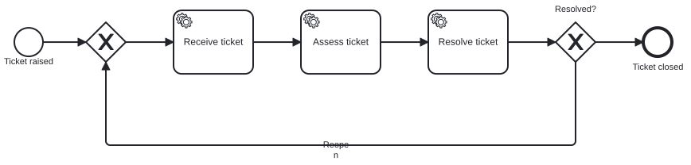

# `@miragon/rules/label-placement`

> This rule is a non-blocking `warn` in both `plugin:@miragon/rules/recommended-for-modeling` and `plugin:@miragon/rules/recommended-for-automation`. In `plugin:@miragon/rules/strict` it is an `error`. Override it to `warn`, `error` or `off` yourself.

Reports a label drawn over a sequence flow or a shape, and a label narrower than the longest word
of its name.

## Why

Labels carry the meaning of a diagram: the event that starts the process, the question a gateway
asks, the condition on a flow. A label drawn across a flow line or another shape is hard to read in
the rendered diagram a stakeholder signs off on, and a reviewer can attach it to the wrong element.
A label narrower than one of its words forces a break inside that word, so "Customer informed"
renders as "Custome / r informed" on a slide or in a review.

## Why this matters for agentic BPMN

Agents and auto-layout write label bounds as plain numbers. The XML diff shows a valid
`<bpmndi:BPMNLabel>`, so nobody notices that the bounds sit on the flow they describe or are too
narrow for the text, until the diagram is rendered.

**Typical AI artifact without this rule:** a flow label placed at the midpoint of its own flow, so
the line runs straight through the text.

**What this rule guarantees:** every label is drawn clear of sequence flows and shapes and is at
least as wide as its longest word.

## Scope

The rule looks at the label bounds (`<bpmndi:BPMNLabel>`) of shapes and sequence flows that have a
name. It reports:

- a label that a sequence flow runs through, its own flow included;
- a label that overlaps a shape other than its own element;
- a label narrower than its longest word.

The width of a word is estimated as 5px per character. That is the low end of the bpmn-js default
label font (Arial at 11px): label bounds bpmn-js measures itself come out at about 5.2px per
character for lowercase words ("Confirmation" is 63px wide). Estimating low keeps a label bpmn-js
sized itself from being reported; a label has to be clearly too narrow. Words are split at
whitespace and hyphens, because a renderer may break the line there.

It deliberately leaves alone:

- a label that reaches less than 2px into a flow or shape, so a label that only grazes it is fine;
- a vertical stretch of the label's own flow, because bpmn-js places a flow label 15px beside a
  vertical flow, so a longer label always straddles it;
- enclosing containers (pools, lanes, groups, expanded sub-processes), boundary events, text
  annotations, data objects and data stores, which labels may be drawn over;
- the host activity of a boundary event, because bpmn-js places a label below its event, which
  puts the label of a boundary event on the top border inside its host;
- elements without a name or without label bounds, such as tasks, whose label is drawn inside the
  shape;
- labels overlapping other labels, and labels of message flows and associations.

## Examples

👎 Invalid: the `Reopen` label is drawn on top of its own loop-back flow

👍 Valid: the same label placed just above the flow

## Further reading

- [Camunda: Creating readable process models](https://docs.camunda.io/docs/components/best-practices/modeling/creating-readable-process-models/): the guidance on labeling elements that a misplaced label breaks.

## Related

- [`@miragon/rules/flow-through-element`](./flow-through-element.md): the same check for a flow drawn through a shape instead of a label.
