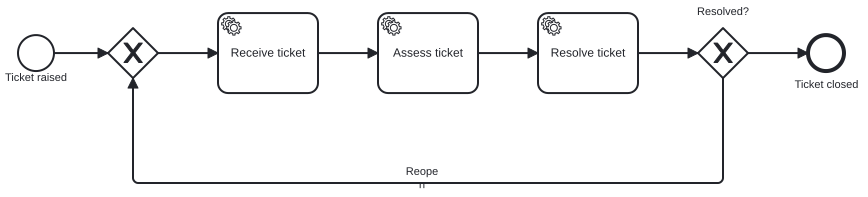

# `@miragon/rules/label-placement`

> This rule is a non-blocking `warn` in both `plugin:@miragon/rules/recommended-for-modeling` and `plugin:@miragon/rules/recommended-for-automation`. In `plugin:@miragon/rules/strict` it is an `error`. Override it to `warn`, `error` or `off` yourself.

Reports a label drawn over a sequence flow or a shape, and a label so narrow that bpmn-js breaks
a word of its name across two lines although a label at most `maxWidth` (90px by default) wide
would keep it whole.

## Why

Labels carry the meaning of a diagram: the event that starts the process, the question a gateway
asks, the condition on a flow. A label drawn across a flow line or another shape is hard to read in
the rendered diagram a stakeholder signs off on, and a reviewer can attach it to the wrong element.
A label that is too narrow forces a break inside a word, so "Subscription requested" renders as
"Subscriptio / n requested" on a slide or in a review.

## Why this matters for agentic BPMN

Agents and auto-layout write label bounds as plain numbers. The XML diff shows a valid
`<bpmndi:BPMNLabel>`, so nobody notices that the bounds sit on the flow they describe or are too
narrow for the text, until the diagram is rendered.

**Typical AI artifact without this rule:** a flow label placed at the midpoint of its own flow, so
the line runs straight through the text.

**What this rule guarantees:** every label is drawn clear of sequence flows and shapes, and bpmn-js
draws every word of it on one line, unless only a label wider than `maxWidth` would.

## Scope

The rule looks at the label bounds (`<bpmndi:BPMNLabel>`) of the named shapes and sequence flows
bpmn-js draws an external label for: events, gateways, data object and data store references,
data inputs and outputs, and sequence flows. It reports:

- a label that a sequence flow runs through, its own flow included;
- a label that overlaps a shape other than its own element;
- a label so narrow that bpmn-js breaks a word inside it, when a label at most `maxWidth` wide
  keeps every word whole.

The rule lays the name out the way bpmn-js 18 (with diagram-js 15.12 or later) draws an external
label (`layoutText` in `diagram-js/lib/util/Text.js`), in the label's own width, and reports the
first word that ends up split across two lines. Text is measured in the bpmn-js label font, Arial at 11px, with the advance
widths and kerning pairs Chrome applies. A word can break even though it fits on its own: when a
line is too wide, bpmn-js estimates how many characters fit from their share of the whole line's
width, so "Subscription" (60.5px) breaks in a 61px label of "Subscription requested". bpmn-js
breaks a line at whitespace, hyphens and soft hyphens, and at every line break in the name. The
message names the smallest wider width at which bpmn-js keeps every word whole.

That width is reported only up to `maxWidth`. bpmn-js lays a new label out 90px wide and breaks a
longer word itself, so a compound such as "Versicherungsbedingungen" (133px) breaks in every
label the modeler draws. Keeping it whole would take a much wider label, or a hyphen or soft hyphen
in the name, which ends up in the element name and everything built from it. So a break that only
a label wider than `maxWidth` avoids is accepted. A label already wider than `maxWidth` is
therefore never reported for a broken word, however little wider it would have to be.

It deliberately leaves alone:

- a label that reaches less than 2px into a flow or shape, so a label that only grazes it is fine;
- a vertical stretch of the label's own flow, because bpmn-js places a flow label 15px beside a
  vertical flow, so a longer label always straddles it;
- enclosing containers (pools, lanes, groups, expanded sub-processes), boundary events, text
  annotations, data objects and data stores, which labels may be drawn over;
- the host activity of a boundary event, because bpmn-js places a label below its event, which
  puts the label of a boundary event on the top border inside its host;
- elements without a name or without label bounds, and elements bpmn-js draws the name inside
  of, such as tasks and sub-processes, even when the DI gives them label bounds;
- the width of a name with a character Chrome's Arial metrics are not known for, because its
  width cannot be predicted without the font. Known are U+0020 to U+007E, U+00A0 to U+00FF, the
  dashes `–` and `—`, the quotes `‘ ’ ‚ “ ” „`, `…`, `•` and `€`; a tab and a carriage return
  count as a space;
- a word break that only a label wider than `maxWidth` avoids;
- other fonts: the layout assumes the bpmn-js default label font;
- labels overlapping other labels, and labels of message flows and associations.

## Configuration

```json
{
  "rules": {
    "@miragon/rules/label-placement": ["error", { "maxWidth": 120 }]
  }
}
```

- `maxWidth`: the widest label, in whole pixels, the rule asks for to keep every word whole (default `90`,
  the width bpmn-js lays a new label out in). Raise it to ask for wider labels instead of accepted
  breaks in long words.

## Examples

👎 Invalid: the `Reopen` label is drawn on top of its own loop-back flow


👍 Valid: the same label placed just above the flow



## Further reading

- [Camunda: Creating readable process models](https://docs.camunda.io/docs/components/best-practices/modeling/creating-readable-process-models/): the guidance on labeling elements that a misplaced label breaks.

## Related

- [`@miragon/rules/label-alignment`](./label-alignment.md): reports a label that sits a few pixels off its element's centre line.
- [`@miragon/rules/flow-through-element`](./flow-through-element.md): the same check for a flow drawn through a shape instead of a label.
