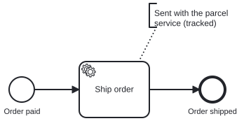
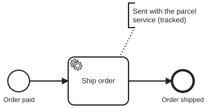

# `@miragon/rules/text-annotation-fit`

> This rule is **off** in every preset, `plugin:@miragon/rules/strict` included (it is a cosmetic check built on a font estimate, meant for diagrams shown on slides or in docs). Enable it by name in your `.bpmnlintrc`.

Reports a text annotation that is shorter than its text plus the padding above and below it, or
narrower than its longest word.

## Why

bpmn-js draws a text annotation as a bracket with a 10px tick at the top and at the bottom. When
the bounds are only as tall as the text, the bottom tick sits on the last line, and on a slide or
in a printed review the annotation looks cut off. An annotation narrower than one of its words
forces a break inside that word. Neither changes what the process does, which is why the rule is
off unless you ask for it.

## Why this matters for agentic BPMN

Agents and auto-layout write annotation bounds as plain numbers, often the default 100 by 30 or the
height of one line, whatever the text. The XML diff shows valid `dc:Bounds`, and nobody notices
the overflowing text until the diagram is rendered for a presentation.

**Typical AI artifact without this rule:** a two-line annotation kept at the height of one line, so
the bottom tick of the bracket runs through the second line.

**What this rule guarantees:** every text annotation leaves the bpmn-js padding free above and below
its text, and every word fits on one line.

## Enable it

Add the rule to the `rules` of your `.bpmnlintrc`, next to whatever preset you extend:

```json
{
  "extends": [
    "bpmnlint:recommended",
    "plugin:@miragon/rules/recommended-for-modeling"
  ],
  "rules": {
    "@miragon/rules/text-annotation-fit": "warn"
  }
}
```

## Scope

The rule looks at the bounds (`dc:Bounds`) of every text annotation with text and estimates the
space its text needs the way bpmn-js 18 renders it:

- **Padding:** 7px on every side (`TEXT_ANNOTATION_PADDING` in `lib/util/AnnotationUtil.js`,
  passed to `renderLabel` for `bpmn:TextAnnotation` in `lib/draw/BpmnRenderer.js`). The bracket
  itself is the `TEXT_ANNOTATION` path in `lib/draw/PathMap.js`.
- **Line height:** 14.4px, the default font size of 12px times the line height ratio of 1.2
  (`DEFAULT_FONT_SIZE` and `LINE_HEIGHT_RATIO` in `lib/draw/TextRenderer.js`).
- **First line shift:** diagram-js draws the text a quarter of the line height above the top
  padding (`layoutText` in `diagram-js/lib/util/Text.js`), so the text needs 3.6px less.
- **Characters:** 5px each, the same estimate as
  [`label-placement`](./label-placement.md). Lines wrap after whitespace, hyphens and soft hyphens, and every
  line break in the text starts a new line.

An annotation is reported when its height is below `lines × 14.4 + 2 × 7 − 3.6` (39.2px for two
lines), or its width is below `longest word × 5 + 2 × 7`. The character width is the low end of the
font, so the rule counts too few lines rather than too many: an annotation has to be clearly too
small to be reported.

It deliberately leaves alone:

- text annotations without text, or with only whitespace;
- other fonts: the estimate assumes the bpmn-js default of 12px, so set the rule to `off` when your
  modeler renders annotations in a smaller font;
- a word wider than the line, which counts as one line (the width check reports it);
- labels of other elements, which [`label-placement`](./label-placement.md) checks.

## Examples

👎 Invalid: the two-line annotation is 34px tall, so the bottom tick sits on its text



👍 Valid: the same annotation 41px tall, with room above and below the text



## Further reading

- [bpmn-js: BpmnRenderer](https://github.com/bpmn-io/bpmn-js/blob/develop/lib/draw/BpmnRenderer.js): how a text annotation and its text are drawn.

## Related

- [`@miragon/rules/label-placement`](./label-placement.md): the same word width check for the labels of events, gateways and flows.
